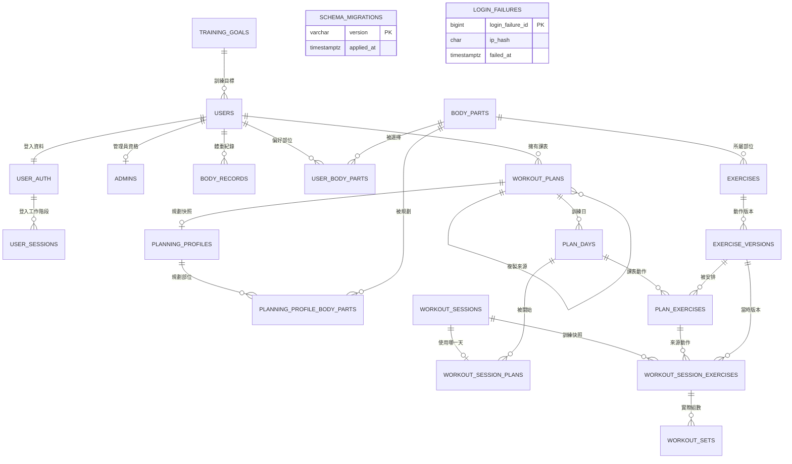
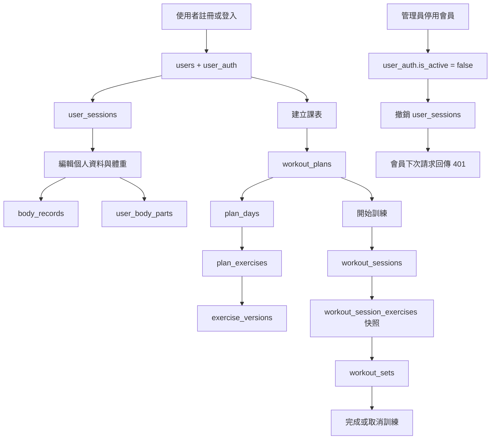

# FitTrack Pro 資料庫關係圖

這是一張給初學者看的總覽圖。先看資料如何連接，再回到
`web/php-app/database/postgres.sql` 查看每個欄位、限制與 Trigger。

## 一、資料表關係總覽

### 圖上的符號

| 符號 | 意思 |
|---|---|
| `||--||` | 一對一，例如 `users` 與 `user_auth` |
| `||--o{` | 一對多，例如一位會員有很多體重紀錄 |
| `USER_BODY_PARTS` | 中間表，負責實作多對多 |
| `EXERCISE_VERSIONS` | 不覆蓋舊資料的版本表 |
| `WORKOUT_SESSION_EXERCISES` | 開始訓練時建立的快照表 |

## 二、使用者實際操作時的資料流

## 三、最重要的理解方式

1. `users` 是「誰」。
2. `exercises` 是「哪個動作」。
3. `workout_plans` 是「預計要做什麼」。
4. `workout_sessions` 是「這次實際做了什麼」。
5. `workout_sets` 是「每個動作實際完成的第幾組、重量與次數」。
6. `exercise_versions` 和 `workout_session_exercises` 共同保護歷史資料不被後續修改破壞。
